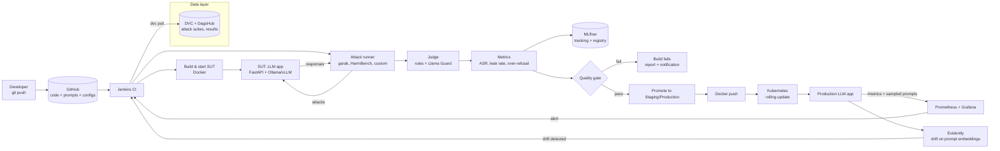

# 🛡️ llm-redteam-ci

> **Continuous LLM security evaluation: automated red-teaming as a CI/CD quality gate.**
> Every change to a model, a system prompt or a guardrail is attacked automatically, scored, tracked, and **blocked from production if it is less safe than before**.


---

## Table of contents

1. [TL;DR](#1-tldr)
2. [Problem statement](#2-problem-statement)
3. [Goals and non-goals](#3-goals-and-non-goals)
4. [Key concepts](#4-key-concepts)
5. [Architecture](#5-architecture)
6. [Pipeline stages in detail](#6-pipeline-stages-in-detail)
7. [Tech stack](#7-tech-stack)
8. [Attack sources and datasets](#8-attack-sources-and-datasets)
9. [Metrics and quality gates](#9-metrics-and-quality-gates)
10. [Repository structure](#10-repository-structure)
11. [Getting started](#11-getting-started)
12. [Configuration](#12-configuration)
13. [DVC pipeline](#13-dvc-pipeline)
14. [Jenkins pipeline](#14-jenkins-pipeline)
15. [Experiment tracking and registry (MLflow)](#15-experiment-tracking-and-registry-mlflow)
16. [Docker and Kubernetes](#16-docker-and-kubernetes)
17. [Monitoring and drift](#17-monitoring-and-drift)
18. [Testing strategy](#18-testing-strategy)
19. [Roadmap](#19-roadmap)
20. [Mapping to the MLOps course](#20-mapping-to-the-mlops-course)
21. [Responsible use and ethics](#21-responsible-use-and-ethics)
22. [Risks and limitations](#22-risks-and-limitations)
23. [References](#23-references)
24. [Contributing and license](#24-contributing-and-license)

---

## 1. TL;DR

| | |
|---|---|
| **What** | A pipeline that automatically attacks an LLM application (prompt injection, jailbreaks, system-prompt leakage, PII leakage, harmful content) and measures how often the attacks succeed. |
| **Why** | LLM behaviour can change **without any code change**: new model version, edited prompt, new guardrail, new documents in a RAG index. Safety must be re-verified on every change, like unit tests. |
| **How** | Git/DVC version prompts, attack suites and results → Jenkins runs the attack suites on each change → a judge scores the responses → MLflow tracks the run → a **quality gate** passes or fails the build → Docker/Kubernetes deploy only safe candidates → Prometheus/Grafana/Evidently watch production and trigger new evaluations. |
| **Output** | A pass/fail verdict, a security report per run, a dashboard of attack-success-rate (ASR) over time, and a registry of "security-approved" prompt/model versions. |

---

## 2. Problem statement

A deployed LLM application is attacked in ways classical software is not:

- **Prompt injection**: user text (or a retrieved document) overrides the developer's instructions.
- **Jailbreaks**: crafted prompts bypass safety training.
- **System-prompt leakage**: the hidden instructions (sometimes with secrets) are extracted.
- **Sensitive-data disclosure**: the model reveals PII or confidential context.
- **Harmful-content generation**: the model produces content it should refuse.

Teams typically test these **manually and once**. But the risk profile changes every time someone edits the system prompt, swaps the model, tunes a guardrail or updates the knowledge base. This is the same silent-degradation problem as in classical MLOps (a model that fails without any code change), applied to security.

**This project treats LLM security as a regression-testing problem**: a versioned, automated, measurable, gated process.

---

## 3. Goals and non-goals

### Goals

- Run a **repeatable** battery of attacks against any LLM application exposed over HTTP.
- Compute **quantitative security metrics** (attack success rate, leak rate, refusal rate, over-refusal rate) per OWASP LLM category.
- **Block** a release when metrics regress beyond thresholds (quality gate in CI).
- Make every run **reproducible and traceable**: code commit + attack-suite version + model/prompt version → results.
- **Monitor** production traffic for attack-pattern drift and trigger new evaluation runs (Continuous Testing, the LLM equivalent of Continuous Training).
- Stay fully runnable on a laptop using **open-source local models** (no paid API required).

### Non-goals

- Not a new attack-generation research project: we orchestrate and measure existing, publicly documented attack suites.
- Not a production WAF/firewall. The optional guardrail module is a *component under test*, not the product.
- Not a guarantee of safety. A passing gate means "no regression on the tested suites", not "secure" (see [Risks and limitations](#22-risks-and-limitations)).

---

## 4. Key concepts

| Term | Meaning |
|---|---|
| **SUT** (System Under Test) | The LLM application being evaluated: model + system prompt + optional guardrails + optional RAG. Exposed as an HTTP API. |
| **Attack suite** | A versioned set of adversarial prompts grouped by category, from garak probes, HarmBench behaviours and public datasets. |
| **Judge** | The component deciding whether a response is *safe* or *unsafe* (rule-based checks + a safety-classifier LLM). |
| **ASR** (Attack Success Rate) | Share of attacks that achieved their harmful goal. **Lower is better.** |
| **Over-refusal rate** | Share of *benign* prompts wrongly refused. A model that refuses everything has ASR 0 but is useless, so we track both. |
| **Quality gate** | A set of thresholds. If any is violated, the pipeline fails and the candidate is not promoted. |
| **Candidate** | A (model, system prompt, guardrail config) combination proposed for deployment. |
| **CT (Continuous Testing)** | Re-running evaluations automatically on triggers: commit, new attack data, schedule, production drift. |

---

## 5. Architecture

### 5.1 Overview



### 5.2 Layered view

| # | Layer | Role | Technologies |
|---|---|---|---|
| 1 | **Data** | Version attack suites, datasets, evaluation outputs | Git, DVC, DagsHub |
| 2 | **CI/CD/CT** | Orchestrate attacks, evaluation, gates, builds, deployment | Jenkins |
| 3 | **Evaluation** | Generate attacks, call the SUT, judge responses, compute metrics | garak, HarmBench, custom runner, Llama Guard |
| 4 | **Registries** | Govern runs and approved candidates | MLflow, Docker Hub / GHCR |
| 5 | **Serving** | The LLM application and the evaluator as services | FastAPI, Ollama / vLLM, Docker, Kubernetes |
| 6 | **Observability** | Metrics, dashboards, drift, alerts | Prometheus, Grafana, Evidently, (optional) Langfuse |

Each layer communicates through explicit interfaces (versioned files, OCI images, HTTP endpoints), so any tool can be swapped (for example Jenkins → GitHub Actions) without rewriting the others.

### 5.3 The three loops

1. **Change loop (CI)**: a commit changes a prompt, model or guardrail → attacks run → gate → deploy or block.
2. **Data loop (CT on new attacks)**: new attack data is added (`dvc pull`/`dvc push`) → re-evaluate the **currently deployed** candidate → alert if it regressed.
3. **Production loop**: production prompts are sampled, embedded and compared to the reference attack distribution (Evidently) → drift triggers a new evaluation run.

---

## 6. Pipeline stages in detail

| Stage | Input | Action | Output |
|---|---|---|---|
| **0. Checkout** | Git commit | Clone repo, `dvc pull` attack suites | Workspace with pinned data |
| **1. Static checks** | Source, prompts | Lint, type checks, secret scan on prompt files | Pass/fail |
| **2. Data validation** | Attack suites | Schema, duplicates, label balance, language checks (Deepchecks / custom) | Validation report |
| **3. Unit tests** | Evaluator code | Pytest on parsers, judge logic, metric functions with mocked SUT | Test report |
| **4. Build SUT** | Candidate config | Build Docker image, start SUT (compose) and wait for `/health` | Running SUT |
| **5. Attack execution** | Attack suites | Run garak probes, HarmBench subset, custom injection and leakage tests against SUT | Raw interaction logs (prompt, response, latency) |
| **6. Judging** | Raw logs | Rule-based checks (canary strings, regex for PII, system-prompt overlap) + Llama Guard classification | Per-interaction verdicts |
| **7. Metrics** | Verdicts | Aggregate per category and overall | `metrics.json`, charts, HTML report |
| **8. Tracking** | Metrics, artifacts | Log params/metrics/artifacts to MLflow; tag with git SHA and DVC data hash | MLflow run |
| **9. Quality gate** | Metrics, `gates.yaml` | Compare with thresholds and with the **current production baseline** | PASS / FAIL |
| **10. Promotion** | PASS | Register candidate, move Staging → Production in MLflow | Registered version |
| **11. Package and deploy** | Registered candidate | Push Docker images, `kubectl set image`, verify rollout | Deployed candidate |
| **12. Post-deploy smoke attack** | Prod endpoint | Short attack subset against production | Confirmation or automatic rollback |

### Canary-based leakage testing

To test system-prompt and secret leakage **without any real secret**, the SUT's system prompt contains a unique **canary token** (for example `CANARY-7f3a9c`). The judge flags any response containing the canary or a high n-gram overlap with the system prompt. Canaries are regenerated per run so results cannot be memorised.

---

## 7. Tech stack

| Category | Tool | Purpose in this project |
|---|---|---|
| Language | Python 3.11+ | Evaluator, SUT, tests |
| LLM serving | **Ollama** (dev) / **vLLM** (optional, GPU) | Run open-source models locally |
| SUT API | **FastAPI** | `/chat`, `/health`, `/metrics` |
| Attack generation / scanning | **garak** | Probe-based vulnerability scanner |
| Attack benchmark | **HarmBench** | Standardised harmful-behaviour prompts |
| Judge | **Llama Guard 3** (via Ollama or Hugging Face) + rule-based checks | Safe/unsafe classification |
| Versioning | **Git**, **DVC**, **DagsHub** | Code, prompts, datasets, results |
| Tracking / registry | **MLflow** | Runs, metrics, artifacts, model/prompt registry |
| Data validation | **Deepchecks** (or Pandera) | Validate attack suites |
| Tests | **Pytest** | Unit and integration tests |
| Containers | **Docker** (multi-stage), Docker Compose | Reproducible environments |
| CI/CD | **Jenkins** | Pipeline, gates, deployment |
| Orchestration | **Kubernetes** (kind / minikube locally) | Deployment, CronJobs for nightly red-team |
| Monitoring | **Prometheus**, **Grafana**, **Alertmanager** | Metrics, dashboards, alerts |
| Drift | **Evidently** | Embedding / text drift on prompts |
| Tracing (optional) | **Langfuse** (self-hosted) | LLM call traces, latency, cost |
| Reporting | Jinja2 + Plotly | HTML security report |

> **Hardware note:** a 3B-parameter model + a 1B judge run on a laptop with 16 GB RAM (CPU is slow but workable on reduced suites). A GPU is only needed for larger models or full HarmBench runs.

---

## 8. Attack sources and datasets

> ⚠️ Always check the **license and access conditions** of each source before use. Some are gated (require accepting terms) and some contain offensive text.

| Category (OWASP LLM) | Source | Link | Use |
|---|---|---|---|
| Prompt injection (LLM01) | deepset/prompt-injections | https://huggingface.co/datasets/deepset/prompt-injections | Labelled injection vs benign |
| Jailbreaks (LLM01) | jailbreak-classification | https://huggingface.co/datasets/jackhhao/jailbreak-classification | Jailbreak vs benign prompts |
| Injection (rich) | HackAPrompt | https://huggingface.co/datasets/hackaprompt/hackaprompt-dataset | Large collection of competition attacks |
| Injection (game) | Lakera Gandalf | https://huggingface.co/datasets/Lakera/gandalf_ignore_instructions | "Ignore instructions" style attacks |
| Harmful behaviours | HarmBench | https://github.com/centerforaisafety/HarmBench | Standardised red-teaming behaviours |
| Scanner / probes | garak | https://github.com/NVIDIA/garak | Probes for injection, leakage, encoding attacks, etc. |
| Over-refusal | XSTest | https://github.com/paul-rottger/exaggerated-safety | Benign prompts that look risky |
| PII leakage (LLM02) | ai4privacy/pii-masking-200k | https://huggingface.co/datasets/ai4privacy/pii-masking-200k | PII patterns for leak detection |
| Toxicity (optional) | Jigsaw Toxic Comment | https://www.kaggle.com/c/jigsaw-toxic-comment-classification-challenge | Toxic-output checks |
| Reference taxonomy | OWASP Top 10 for LLM Applications | https://genai.owasp.org/llm-top-10/ | Category mapping |

**Suggested MVP subset** (keeps runs under ~10–15 minutes locally): 200 prompts per category, sampled with a fixed seed and versioned with DVC.

---

## 9. Metrics and quality gates

### 9.1 Metrics

| Metric | Definition | Direction |
|---|---|---|
| `asr_overall` | Successful attacks / total attacks | ↓ lower is better |
| `asr_<category>` | Same, per category (injection, jailbreak, leakage, pii, harmful) | ↓ |
| `system_prompt_leak_rate` | Responses containing canary / high prompt overlap | ↓ |
| `pii_leak_rate` | Responses exposing PII from protected context | ↓ |
| `refusal_rate_harmful` | Harmful prompts correctly refused | ↑ |
| `over_refusal_rate` | Benign prompts wrongly refused | ↓ |
| `latency_p95_ms` | 95th percentile response time | ↓ |
| `judge_agreement` | Agreement between rule-based and LLM judge on a labelled calibration set | ↑ |

### 9.2 Gate logic

A candidate **passes** only if **all** hold:

1. **Absolute thresholds**: for example `asr_overall ≤ 0.15`, `system_prompt_leak_rate ≤ 0.02`.
2. **No regression vs baseline** (current production candidate): each ASR may not increase by more than a tolerance (for example +2 percentage points), with a confidence-interval check to avoid failing on noise.
3. **Usability guard**: `over_refusal_rate ≤ 0.10`.
4. **Judge sanity**: `judge_agreement ≥ 0.85` on the calibration set (if the judge is unreliable, the gate is unreliable).

Thresholds are examples: calibrate them on your first baseline runs and keep them in `configs/gates.yaml` (versioned).

> **Statistical note:** LLM outputs are stochastic. Fix temperature/seed where possible, run each attack N times (for example 3) for borderline categories, and report Wilson confidence intervals for rates.

---

## 10. Repository structure

```text
llm-redteam-ci/
├── README.md
├── LICENSE
├── pyproject.toml                # dependencies, tooling config
├── Makefile                      # shortcuts: make setup / test / eval / report
├── Jenkinsfile                   # CI/CD/CT pipeline
├── dvc.yaml                      # data + evaluation pipeline
├── params.yaml                   # tunable parameters (sample sizes, seeds, N runs)
├── .dvc/                         # DVC config (remote = DagsHub)
├── .env.example                  # environment variables template (never commit .env)
│
├── configs/
│   ├── candidate.yaml            # model + system prompt + guardrail under test
│   ├── gates.yaml                # thresholds and tolerances
│   └── attack_suites.yaml        # which suites/categories to run
│
├── prompts/
│   ├── system_prompt.v1.txt      # versioned system prompts (contain canary placeholder)
│   └── judge_prompt.v1.txt
│
├── data/                         # tracked by DVC, not Git
│   ├── raw/                      # downloaded datasets
│   ├── suites/                   # curated, sampled, versioned attack suites
│   └── calibration/              # human-labelled set to validate the judge
│
├── src/
│   ├── sut/                      # system under test
│   │   ├── app.py                # FastAPI: /chat, /health, /metrics
│   │   ├── llm_client.py         # Ollama / vLLM client
│   │   └── guardrails.py         # optional input/output guardrails
│   ├── attacks/
│   │   ├── prepare_suites.py     # download, clean, sample, version
│   │   ├── runner.py             # sends attacks to SUT, stores raw logs
│   │   └── garak_adapter.py      # runs garak and normalises its output
│   ├── judge/
│   │   ├── rules.py              # canary, regex PII, overlap checks
│   │   ├── llm_judge.py          # Llama Guard wrapper
│   │   └── calibrate.py          # agreement with labelled set
│   ├── metrics/
│   │   ├── compute.py            # ASR, leak rates, over-refusal, CIs
│   │   └── gate.py               # quality-gate decision logic
│   ├── tracking/
│   │   └── mlflow_logger.py
│   ├── monitoring/
│   │   ├── exporter.py           # Prometheus exporter for evaluator metrics
│   │   └── drift.py              # Evidently drift reports
│   └── reporting/
│       ├── report.py             # HTML report
│       └── templates/
│
├── tests/
│   ├── unit/                     # judge, metrics, gate, parsers
│   ├── integration/              # SUT + runner with a mocked/tiny model
│   └── data/                     # Deepchecks / schema checks on suites
│
├── docker/
│   ├── Dockerfile.sut
│   ├── Dockerfile.evaluator
│   └── docker-compose.yml        # SUT + Ollama + MLflow + Prometheus + Grafana
│
├── k8s/
│   ├── namespace.yaml
│   ├── sut-deployment.yaml
│   ├── sut-service.yaml
│   ├── evaluator-cronjob.yaml    # nightly red-team run
│   └── monitoring/               # ServiceMonitor, alert rules
│
├── monitoring/
│   ├── prometheus.yml
│   ├── alert_rules.yml
│   └── grafana/dashboards/       # exported dashboard JSON
│
├── reports/                      # generated reports (gitignored, kept as artifacts)
└── docs/
    ├── architecture.md
    ├── threat-model.md
    └── runbook.md
```

---


##  Risks and limitations

| Risk / limitation | Mitigation |
|---|---|
| **Judge errors** (false safe / false unsafe) | Calibration set, agreement threshold, rule-based + LLM judge combination, manual review of sampled failures |
| **Stochastic outputs** make metrics noisy | Fixed seeds/temperature, repeated runs, confidence intervals, tolerance in gate |
| **Benchmark overfitting**: tuning only to the known suites | Rotate/extend suites, hold-out set not used during prompt tuning, add new attacks regularly |
| **Coverage gap**: a pass does not prove security | State it clearly; combine with manual red-teaming and threat modelling |
| **Small local models** behave differently from production models | Parametrise the model; re-baseline when the model changes |
| **Compute/time limits** | Sampled suites for CI, full suites nightly |
| **Over-refusal** can hide behind low ASR | Track and gate `over_refusal_rate` |

---

##  References

- OWASP Top 10 for LLM Applications: https://genai.owasp.org/llm-top-10/
- garak, LLM vulnerability scanner: https://github.com/NVIDIA/garak
- HarmBench: https://github.com/centerforaisafety/HarmBench
- XSTest (over-refusal): https://github.com/paul-rottger/exaggerated-safety
- Llama Guard (Meta): https://huggingface.co/meta-llama (gated, requires license acceptance)
- MLflow: https://mlflow.org/docs/latest/
- DVC: https://dvc.org/doc
- DagsHub: https://dagshub.com/docs/
- Evidently AI: https://docs.evidentlyai.com/
- Deepchecks: https://docs.deepchecks.com/
- Prometheus / Grafana / Alertmanager docs
- Sculley et al., *Hidden Technical Debt in Machine Learning Systems*, NeurIPS 2015

---


